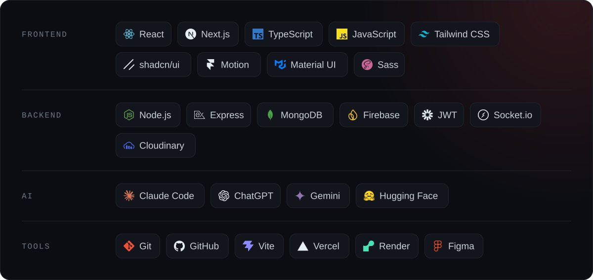
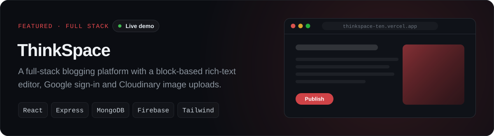
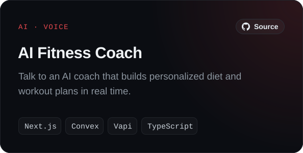
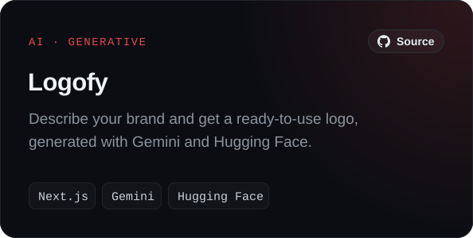
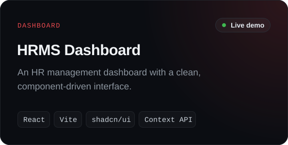
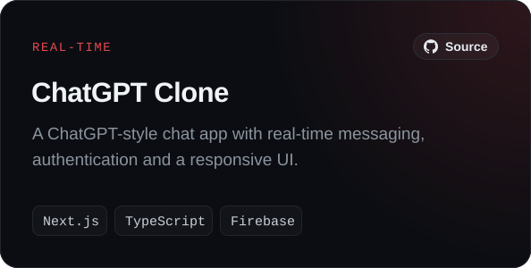
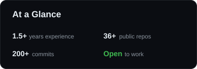

  
  
  
  

### About

I'm a full stack developer from Jaipur, India, with **1.5+ years** of experience building fast, responsive and pixel-perfect web apps. I live in the **React and Next.js** ecosystem, and I'm going deep on the backend with **Node.js, Express and MongoDB**.

- Building AI-powered web apps with Next.js and the Gemini API
- Leveling up on REST APIs, authentication and database design
- Open to **full-time roles** and **freelance projects**

### Stack

### Selected Work

  
  
  
  

### GitHub

  
  

Thanks for stopping by. The fastest way to reach me is <a href="mailto:gouraw1@gmail.com">gouraw1@gmail.com</a>.
